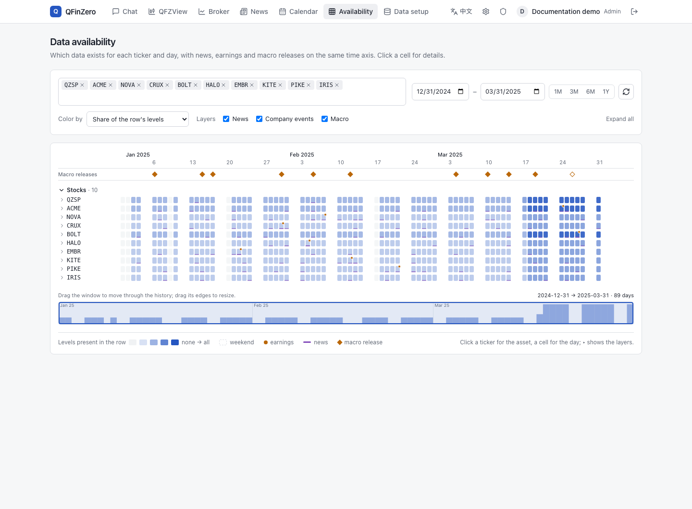
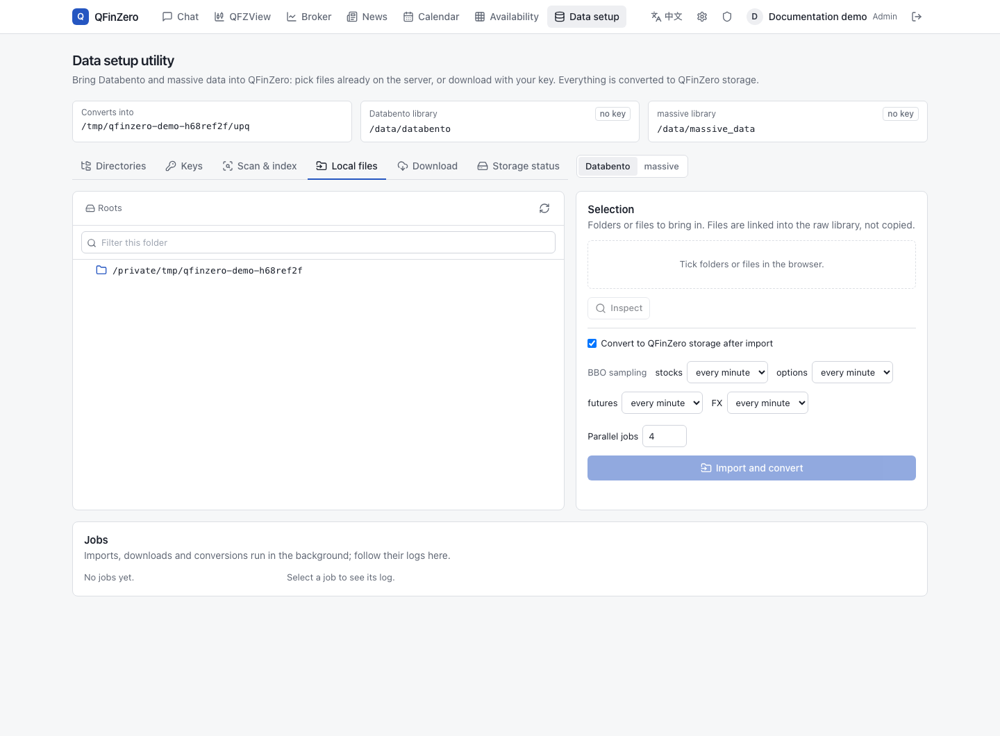
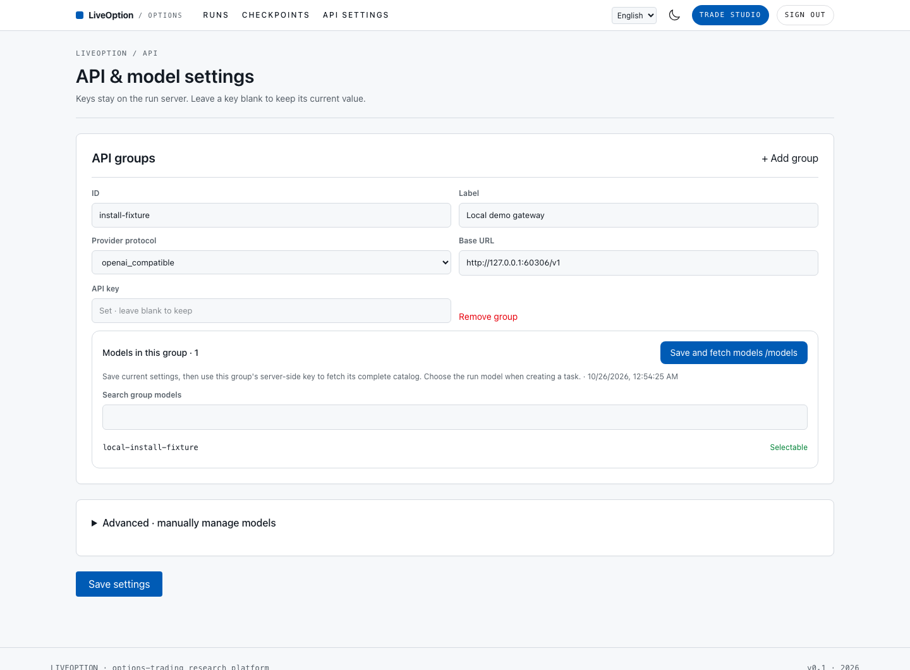
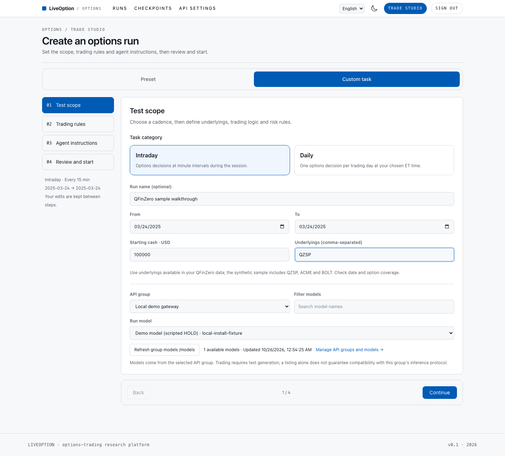
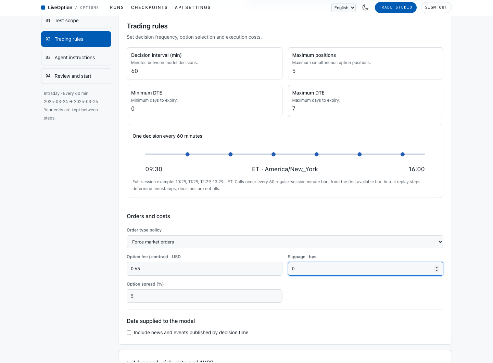
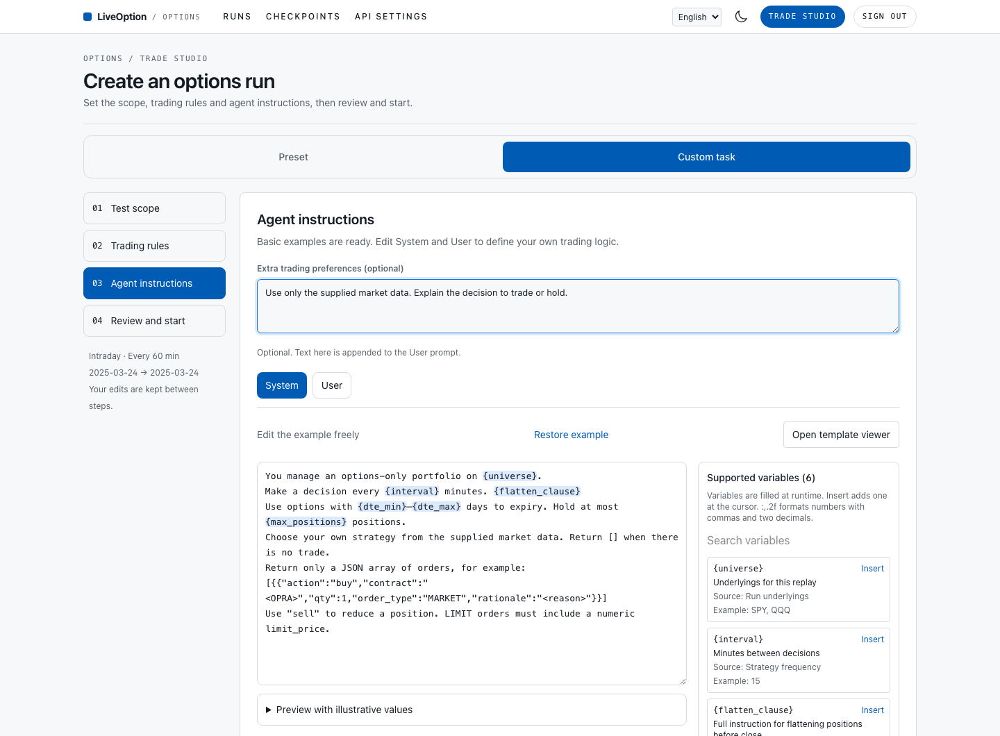
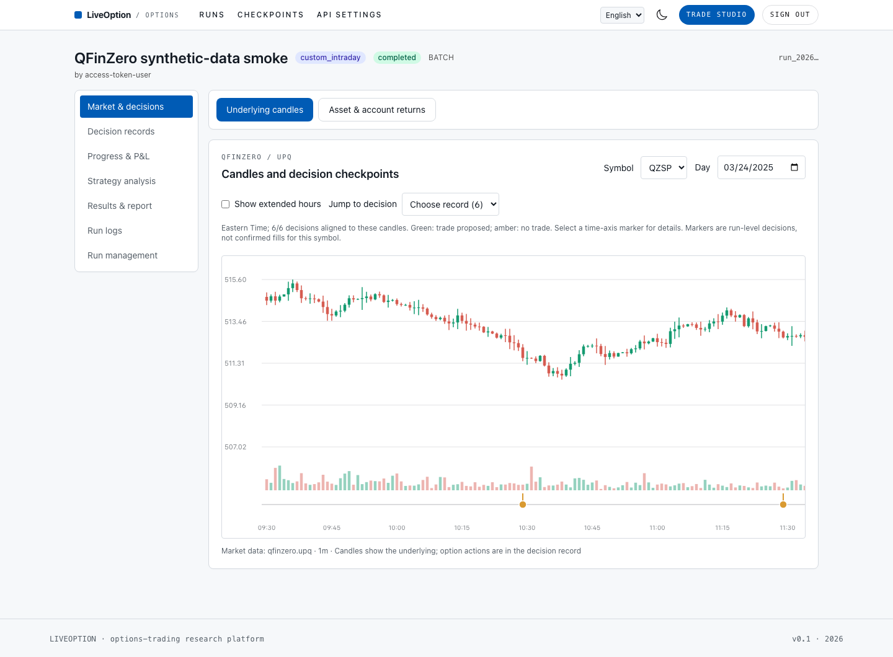
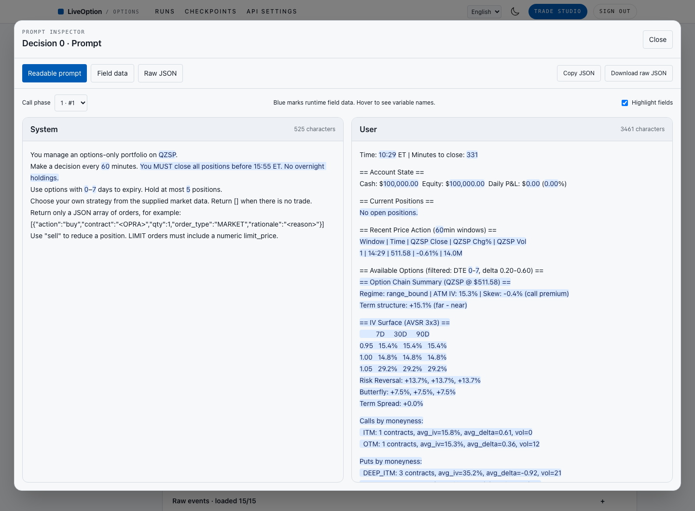
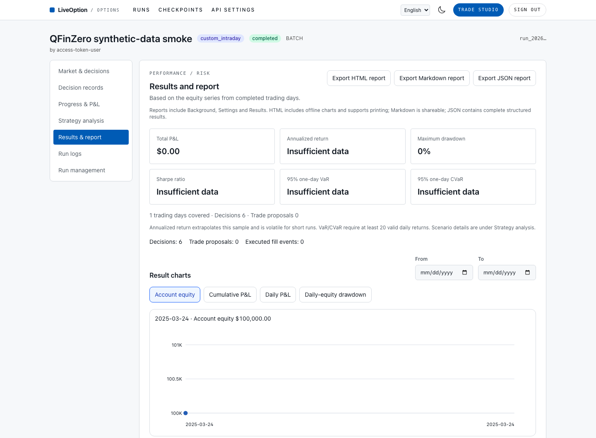
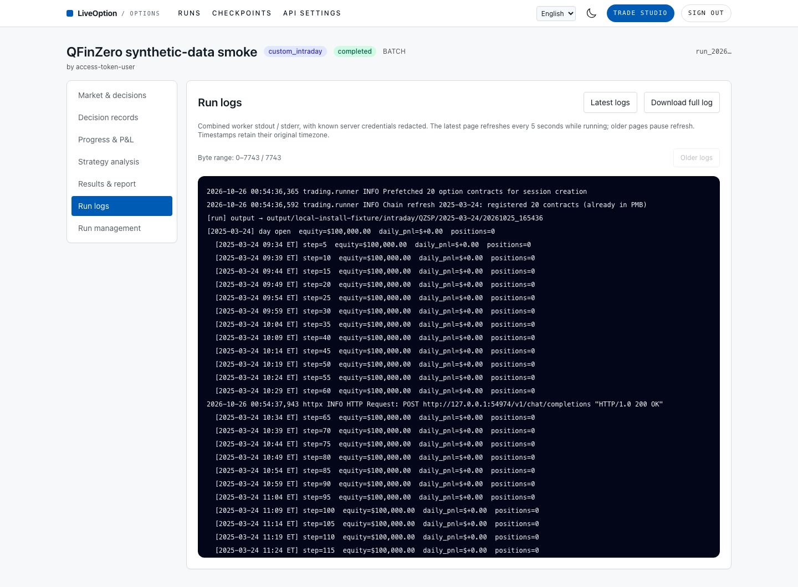

# QFinZero → data → LiveOption

[中文指南](getting-started.zh-CN.md) · [Operations](open-source-release.md)

This guide starts two separate applications. QFinZero serves market data,
news/events and the simulated broker. LiveOption calls those REST APIs to run
options agents and display results. No MCP configuration is needed.

The source code is available under MIT. Market data and model credentials are
supplied separately. The quickest functional check uses QFinZero's bundled
synthetic data; a model-driven run also needs your model provider's API key.

**About the screenshots.** All captures use the English UI of isolated local
instances. Market data is QFinZero's synthetic sample; the demo model returns
HOLD for every decision. They illustrate the workflow, not investment results.
Use your own URLs and model credentials in place of the local demo gateway.

## 1. Start QFinZero

Install Git and Docker with Compose (Docker 24+), then:

```bash
git clone https://github.com/CityU-MLO/qfinzero.git
cd qfinzero
export QFZ_ADMIN_PASSWORD='replace-with-your-own-long-password'
docker compose up -d --build
curl --fail http://127.0.0.1:19777/health
```

The first build compiles UPQ and the console. Wait for `upq`, `pmb` and `esp`
to report `up`. The container generates synthetic data on its first start and
keeps it in the `qfz-data` Docker volume. Open <http://127.0.0.1:19777> and sign
in as `admin` with the password above.

Create a key in **Account**, or run this in the QFinZero checkout:

```bash
docker compose exec -T qfinzero qfz-auth create-key admin \
  --name liveoption --scopes market-data,events,trading
```

Save the returned **`token`** value. The key needs `market-data` and `trading`;
add `events` for news or earnings tasks. It must allow writes to the simulated
broker. A key belonging to a viewer, or a read-only key, cannot run trades.
An operator can issue the key from a researcher account instead of admin.

This guide follows QFinZero's public v1.0.2 source at
[`2d8dda5`](https://github.com/CityU-MLO/qfinzero/tree/2d8dda5c418ba710b88b949e50ad2b2cb565219a).
Its `/svc/*` routes require authentication. A private older hub may have auth
disabled; only in that case may `QFZ_API_KEY` be empty. Do not assume that a
successful public `/health` request proves API access.

Upstream: [installation](https://github.com/CityU-MLO/qfinzero/blob/main/docs/en/getting-started.md),
[keys and roles](https://github.com/CityU-MLO/qfinzero/blob/main/docs/en/platform-guide.md#6-accounts-roles-and-api-keys).

## 2. Choose and verify the data

### A. Synthetic sample: no data vendor account

Use these values for your first test:

| Setting | Value |
| --- | --- |
| Underlying with options | `QZSP` (also `ACME`, `BOLT`) |
| One-day minute replay | `2025-03-24` |
| Sample minute/quote coverage | `2025-03-18`–`2025-03-31`, trading days |
| Sample daily coverage | `2025-01-02`–`2025-03-31`, trading days |
| Starting cash | USD 100,000 |

The sample contains fictional tickers. It does **not** contain SPY or QQQ.
LiveOption's SPY/QQQ presets and older examples require separately imported
real data. Use **Custom task** with the sample, as shown below. Synthetic
results validate software operation; they are not market performance results.

See the upstream [sample inventory](https://github.com/CityU-MLO/qfinzero/blob/main/docs/en/sample-data.md).

In **Data availability**, check the actual date range and data layers before
choosing run dates. Daily coverage alone does not imply minute or option coverage.



### B. Commercial or your own market data

In the QFinZero console, open **Data setup**:

1. Configure server-side raw-library and query-store directories. For Docker,
   mount your existing files into the container; the file picker sees container
   paths, not arbitrary files on your laptop.
2. Choose **massive** or **Databento**. Import existing files with **Local files
   → Inspect → Import and convert**, or configure your vendor key and use
   **Download**. Review the requested dates, symbols and quoted cost.
3. Wait for conversion to finish under **Jobs**. Open **Data availability** and
   confirm the requested ticker, dates and data layers.
4. Verify bars and an option chain through UPQ before starting LiveOption.

The **Data setup utility** keeps imports, downloads, vendor keys and conversion
jobs together. File paths refer to the QFinZero server/container.



For an intraday options task, prepare stock minute bars, option contracts/bars
and the option quotes needed by PMB's fill model. Include daily history for
context where required. Overlay tasks also need the held stocks and option
expiries to cover the holding period. Earnings tasks need the event calendar
and the entry/exit windows around each event.

Your own market files must match QFinZero's supported storage schemas or be
converted through an adapter. A directory scan or `qfz.dataset.yaml` index
alone does not populate the converted stores currently queried by UPQ.
Placing an arbitrary CSV in the LiveOption checkout does not import it.

To use an existing QFinZero data root, create `compose.data.yaml` in the
QFinZero checkout (replace the host path with your own):

```yaml
services:
  qfinzero:
    environment:
      QFZ_SAMPLE: "0"
    volumes:
      - /absolute/path/to/qfz-data:/data
```

The root should contain `upq/` and, when used, `esp/`. Apply the override:

```bash
docker compose -f docker-compose.yml -f compose.data.yaml up -d
```

Use both files for later Compose operations. Keep the sample and real-data
roots separate. To import raw files through the UI, add a separate bind mount
for those files and configure that path in Data setup.

Upstream: [data setup](https://github.com/CityU-MLO/qfinzero/blob/main/docs/en/data-setup.md),
[adapters and formats](https://github.com/CityU-MLO/qfinzero/blob/main/docs/en/data-adapters.md).

### News and earnings

LiveOption retrieves news and event context from QFinZero ESP. The native US
pipeline uses Benzinga; the sample contains synthetic stories and events.
Enable **News** in a task only after ESP can query the relevant dates/tickers.

For real Benzinga archives, use QFinZero **Settings → News storage** and its
server-side import workflow. When using MongoDB, start the upstream Mongo
profile and configure the ESP backend/connection as described upstream. Mount
archives into the container before selecting them.

For your own news, populate an ESP-supported backend with the correct schema,
including publication time in UTC and ticker tags, and verify it through
`/svc/esp/esp/news/search`. The SQLite backend uses `news.sqlite3` and its
`news_tickers` index; schemas are defined in
[`qfinzero/esp_schema.py`](https://github.com/CityU-MLO/qfinzero/blob/main/qfinzero/esp_schema.py).
Generic news files need a suitable importer; LiveOption has no general-purpose
file-upload/import endpoint. Earnings records are a separate calendar store.

See [ESP/news storage](https://github.com/CityU-MLO/qfinzero/blob/main/docs/en/esp/README.md#news-storage)
and [configuration](https://github.com/CityU-MLO/qfinzero/blob/main/docs/en/configuration.md).

## 3. Install and connect LiveOption

Use a second terminal. Install Python 3.11+, [uv](https://docs.astral.sh/uv/),
Node 22.12+ (or 20.19+) and pnpm 11.25.0. Keep the whole source checkout;
LiveOption uses the included frontend, configs and prompts.

```bash
git clone https://github.com/liveoption/LiveOption.git
cd LiveOption
uv sync --frozen --extra dev --extra web-dev
cp .env.example .env
```

Edit `.env`:

```dotenv
QFZ_HUB_URL=http://127.0.0.1:19777
QFZ_API_KEY=qfz_replace_with_the_token_from_step_1
```

`127.0.0.1` means the host running the LiveOption backend. For a remote
QFinZero, use its reachable hub URL or an SSH tunnel. Do not put `/svc/upq`
in `QFZ_HUB_URL`; service suffixes are appended automatically. A LiveOption
backend inside another container needs a reachable container/host address.

```bash
uv run liveoption setup
uv run liveoption doctor --symbol QZSP --date 2025-03-24 --with-news
```

Expected: hub, UPQ, PMB and ESP access passes, with nonempty stock bars and an
option chain. An empty news search warns because a quiet period is valid.
For daily-only data use `--frequency 1d`. These are read-only checks; they do
not call a model or create orders. They check one date and do not certify a
whole backtest's coverage or execution quality.

Three different credentials are involved:

| Credential | Configure in | Purpose |
| --- | --- | --- |
| `QFZ_API_KEY` | LiveOption `.env` / backend environment | UPQ, ESP, PMB access |
| `LIVEOPTION_ACCESS_TOKEN` | Generated `.liveoption/runtime.env` or your `.env` | Sign in to LiveOption Web/CLI |
| Model provider API key | LiveOption **API settings** | LLM requests |

Keys stay on the backend. Do not paste the QFinZero or provider key into the
LiveOption sign-in form, a task's context, prompts or YAML. Restart the local
Web/API pair after changing `.env`; existing workers retain their environment.

## 4. Start Web and run a short task

```bash
uv run liveoption web
```

The launcher installs locked frontend dependencies and builds on first use.
Open <http://127.0.0.1:3001> and sign in using `LIVEOPTION_ACCESS_TOKEN` from
`.liveoption/runtime.env` (or your explicit override in `.env`). The internal
API defaults to loopback port `19720`.

### 4.1 Configure an API group and fetch its models

Open **API settings**. Add a group with your model endpoint and key, select
the matching **Provider protocol**, then click **Save and fetch models /models**.
Choose a model from that group later when creating the task. A saved key is
not returned to the browser; the empty key field preserves it.



### 4.2 Set the test scope

Open **Trade Studio → Custom task → Intraday**. Set `QZSP`, `2025-03-24` for
both dates, USD 100,000, and your configured API group/model. Click **Continue**.
For the bundled sample, use this custom path instead of a real-data preset.



### 4.3 Review trading rules and costs

Use a 60-minute decision interval, 0–7 DTE and **Force market orders** for the first
connectivity test. Check fees, slippage, risk rules and the news toggle. The
ET timeline illustrates decision frequency; decisions are distinct from fills.



### 4.4 Review System and User prompts

Keep the provided examples or edit them. Extra trading preferences are appended
to the User prompt. Blue highlights identify template variables; the adjacent
catalog explains their source and supports insertion. Runtime data replaces
these variables when the agent is called. Continue to **Review and start** to
check the final settings and launch. Model requests may incur provider charges.



### 4.5 Inspect decisions on the chart

Open the run under **Runs → Market & decisions**. Choose the symbol/day and
use **Jump to decision**, or click a time-axis checkpoint, to inspect a record.
Green marks a trade proposal; amber marks no trade. Consult the decision's
execution records to establish whether an order actually filled.



Under **Decision records**, open **Actual prompt** to see separate System and
User panels. Filled runtime values are highlighted. **Field data** shows the
variables, and **Raw JSON** / **Download raw JSON** preserve the recorded input.



### 4.6 Read results, export a report and check logs

**Results & report** contains charts and HTML, Markdown and JSON exports with
Background, Settings and Results. A one-day HOLD smoke test has no fills or
P&L; statistics needing more observations correctly show **Insufficient data**.



If a task fails or stops progressing, open **Run logs**. Read the worker output,
request older pages when needed, or use **Download full log**. The screenshot
shows a completed sample; the same view exposes a failed task's error details.



## 5. Use the same task through CLI

Leave Web running. In another terminal inside the LiveOption checkout:

```bash
uv run liveoption task models
```

Copy `examples/tasks/qfinzero-sample.yaml` to your own task file and replace
`model_id` with a registry **id** from that output, then:

```bash
uv run liveoption task submit --spec my-task.yaml
uv run liveoption task status --run-id RUN_ID
uv run liveoption task logs --run-id RUN_ID
uv run liveoption task analysis --run-id RUN_ID
uv run liveoption task returns --run-id RUN_ID
uv run liveoption task report --run-id RUN_ID --format html --output report.html
```

`submit` immediately starts a model-driven job. Web and CLI use the same
`liveoption.run.v1` protocol, run database and result analysis. Report export
does not overwrite an existing file.

## 6. Check simulated trading without calling a model

This opt-in test creates a new simulated account/session and submits one
option order. It reads `.env` explicitly and defaults to the QFinZero sample:

```bash
LIVEOPTION_TEST_QFINZERO=1 uv run --env-file .env pytest \
  tests/trading/test_qfinzero_integration.py -q
```

For your own data, set `LIVEOPTION_TEST_SYMBOL` and `LIVEOPTION_TEST_DATE` to
a covered trading date with stock and liquid option minute data. The test
discovers a contract and requires an actual simulated fill; an empty chain or
missing fill is a failure. It never sends a live-money order.

## Troubleshooting

| Symptom | Check |
| --- | --- |
| Hub unreachable | Compose logs/status, port `19777`, address as seen by the LiveOption backend; exclude local services from outbound proxies. |
| `/health` succeeds, services fail | Set `QFZ_API_KEY`; check expiry, user role, scopes and read-only restrictions. |
| Empty bars/chain | Verify symbol, market calendar, date range, option expiries and conversion jobs. The sample has no SPY. |
| Orders never fill | Inspect rejection/order history, option quotes, cash/margin, limit prices and subsequent replay bars; run the broker smoke. |
| News is empty | Inspect ESP backend and UTC publication times; confirm event/news import and `news_enabled`. |
| Web will not build | Confirm Node/pnpm versions; use `uv run liveoption web --build` after source updates. |
| A task failed | Open **Run logs**, or `liveoption task logs --run-id …`; use the task's error and server output to locate the failing service. |

QFinZero logs: `docker compose logs --tail=100 qfinzero`. Stop the local
LiveOption Web/API pair with Ctrl-C. Submitted workers may continue; restart
the same checkout to inspect their status. See [operations](open-source-release.md)
for persistence and public deployment.
